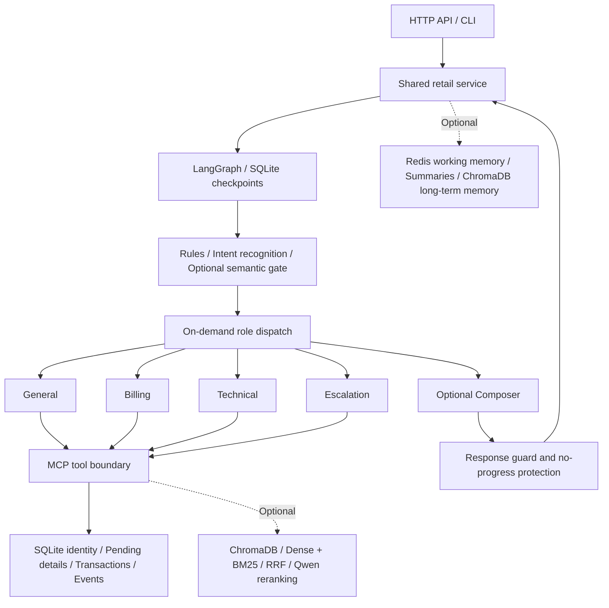

# OrderWeave

**Stateful multi-agent retail support with LangGraph, MCP, and guarded transactions.**

[简体中文（默认）](README.md) · [Evaluation guide](evaluation/README.md) · [Results and scope](evaluation/RESULTS.md) · [MIT](LICENSE)

OrderWeave connects intent recognition, on-demand role collaboration, order tools, and a recoverable state graph. It focuses on multi-turn workflows: understand a request, verify identity and order facts, present complete return details, wait for confirmation, and commit through server-side checks.

The public code is intended for research, learning, and local demonstrations. Users supply fictional sandbox orders separately. A return request is not a real refund, and a handoff is only a simulated record.

## Features

- **Shared entry points:** FastAPI and an interactive CLI use the same retail service. The default is `multi + langgraph`, with explicit single-agent and legacy fallbacks.
- **On-demand collaboration:** general, technical, billing, and escalation roles. Only the primary role can bind identity, prepare or submit a return, or record a handoff; supporting roles are read-only.
- **Recoverable workflows:** SQLite checkpoints and LangGraph Interrupt/Resume wait for a later user message after return details are displayed. Changed details require a new confirmation.
- **Guarded tools:** a real stdio MCP subprocess and server-side identity, displayed-details, and current-message checks, plus transactions, deduplication, and unknown-result protection.
- **Recognition and retrieval:** rules, structured LLM classification, optional local semantic gating, and optional Dense + BM25 + RRF retrieval with local Qwen reranking.
- **Observability:** stage-level tool traces, routing, response guards, and budget records; optional Redis/ChromaDB memory and Prometheus monitoring.

## Architecture



The graph advances the workflow; the Store owns business authorization. Model output, summaries, client `user_id`, and intent labels cannot authorize a submission. Recovery does not automatically replay uncertain writes.

## Algorithms and control mechanisms

| Component | Implementation | Boundary |
| --- | --- | --- |
| Intent and routing | Rule priorities, structured LLM classification, and multi-source fusion; six retail intents mapped to four roles | Classification cannot bind identity or authorize transactions |
| Optional semantic path | Qwen3 document embeddings and a ridge-regression linear head, gated by score, margin, same-class reference similarity, and task state | Scores are not correctness probabilities; external calibrated artifacts are required |
| Hybrid retrieval | ChromaDB Dense, BM25 (k1=1.2, b=0.75), equal-weight RRF (constant 60) | Knowledge explains policy; it does not establish business state or authorization |
| Local reranking | Qwen3-Reranker using final-position yes/no relevance scores, in a separate process | External weights are required; invalid caches fail explicitly without implicit downloads |
| Transactions and recovery | Prepare → display unchanged details → later confirmation → transactional submission | Cancelling a pending return is not cancelling an order; unknown results are not blindly retried |
| Response guard | Check current owned-order facts, item lists, amounts, and events; ask specific questions when verification fails | Limited formats and predicates, not a complete free-text semantic audit |
| No-progress protection | Two consecutive guard fallbacks with unchanged facts explicitly fail the attempt; new facts or a valid response can recover | An early failure remains a failure in scoring |
| Memory | Optional Redis working memory and summaries, ChromaDB episodic/profile memory, plus bounded SQLite-visible history | Profiles are off by default; history cannot establish identity or confirmation |

## Business walkthrough

This illustrates the interaction contract, not a recording of a deployed service or a new model evaluation.

```text
Customer: I want to return a delivered item.
Assistant: Please provide your own email, or full name and zip code.
Customer: Supplies identity details from the locally prepared external sandbox.
Assistant: Verifies identity, reads owned orders, and asks for items and refund destination.
Customer: Specifies the items and a permitted destination.
Assistant: Prepares and displays the order, items, quantities, estimate, destination, and operation ID.
Customer: Confirms in a later turn, or changes/cancels the pending request or asks for a human.
Assistant: Submits after server validation and reports “return requested,” without claiming money has arrived.
```

Displayed details can survive a service restart. Reusing confirmation must not create another write. Missing destinations, conditions, and changes require clarification or a fresh display and confirmation.

## Requirements

- Windows, Python 3.12, and [uv](https://docs.astral.sh/uv/). Other platforms have not received equivalent validation.
- An Anthropic Messages-compatible provider. Real requests require your credentials and an explicit budget.
- **Lightweight business mode:** external order seed, policy, and a model service; no Redis, ChromaDB, or local Qwen is required.
- **Extended configuration:** additionally requires the relevant services, local models, knowledge assets, and semantic artifacts.

### 1. Install

From the repository root:

```powershell
uv python find 3.12
uv sync --locked --group dev
Copy-Item .env.example .env
```

The repository distributes **no evaluation datasets, runtime orders, knowledge collections, reference vectors, or model weights**. Cloning the source does not recreate the maintainer's private evaluation environment.

### 2. Explicitly prepare external runtime assets

The preparation tool connects to the network only with `--download`. It retrieves the fictional retail seed, policy, and LICENSE from a pinned upstream commit and verifies SHA-256 hashes:

```powershell
uv run python -m evaluation.prepare_assets --download
# Verify existing local assets without network access:
uv run python -m evaluation.prepare_assets
```

The default directory is `data/retail-assets/`, which is ignored by Git. You may obtain matching files yourself and use `--directory`, updating the environment paths accordingly. The tool does not download tasks, gold labels, knowledge collections, or models.

The source is a [pinned τ²-bench commit](https://github.com/sierra-research/tau2-bench/tree/fc0055dc4e0a316c3f83133267fbd6faaa770992). Its license remains applicable; see [third-party notices](THIRD_PARTY_NOTICES.md).

### 3. Configure the provider and budget

Edit the local `.env`:

```dotenv
ANTHROPIC_API_KEY=your-own-key
ANTHROPIC_BASE_URL=your-compatible-endpoint
LLM_MODEL=your-provider-model-id
RETAIL_INPUT_CNY_PER_MTOK=current-input-price
RETAIL_OUTPUT_CNY_PER_MTOK=current-output-price
RETAIL_BUDGET_CNY=1
```

Prices are CNY per million tokens and must be verified against your provider. The template intentionally leaves them empty; startup rejects missing or invalid rates. The ledger reserves a request upper bound and records usage. It is not a provider invoice, and the budget does not guarantee the same number of turns across models.

The template disables knowledge, external memory, and semantic shortcuts, using a new local SQLite business database and checkpoint. Do not use real customer information in this demonstration sandbox.

### 4. Run the API or CLI

```powershell
# API, bound to 127.0.0.1:8000 by default
uv run python -m api.main

# Alternatively, use a separate CLI run
uv run python -m api.main --cli
```

Open `http://127.0.0.1:8000/docs` for the API explorer:

```powershell
Invoke-RestMethod http://127.0.0.1:8000/health
$body = @{ message = "Hello, I want to return an item"; user_id = "demo-client"; conv_id = "demo-conversation" } | ConvertTo-Json
Invoke-RestMethod http://127.0.0.1:8000/chat -Method Post -ContentType "application/json; charset=utf-8" -Body ([Text.Encoding]::UTF8.GetBytes($body))
```

Keep `user_id` and `conv_id` unchanged across turns. Obtain sandbox identity and order values from your external local seed. Changing client identifiers does not grant access to another customer's orders.

| Endpoint | Purpose |
| --- | --- |
| `GET /health` | Active mode, tools, and budget state |
| `POST /chat` | Multi-turn support |
| `GET /trace/tool/{request_id}` | Tool and control traces for a request |
| `GET /skills` | Loaded Skills |
| `GET /monitor`, `GET /metrics` | Monitoring, subject to mode and configuration |
| `POST /search` | Optional knowledge retrieval; disabled in lightweight mode |

## Optional configuration

| Setting | Default / behavior |
| --- | --- |
| `RETAIL_AGENT_MODE` | `multi`; `single` is available |
| `RETAIL_WORKFLOW_MODE` | `langgraph`; `legacy` is available |
| `RETAIL_ENABLE_MEMORY` | Template: `false`; enabling requires Redis, ChromaDB, and local memory-encoder cache |
| `RETAIL_ENABLE_KNOWLEDGE` | Template: `false`; requires local knowledge matching the existing validation contract |
| `RETAIL_SEMANTIC_ROUTING` | Template: `false`; requires external semantic artifacts and matching Qwen encoder |
| `RETAIL_SEMANTIC_MODEL_PATH` | External classifier and reference vectors; not distributed |
| `RETAIL_EMBEDDING_MODEL` | `qwen`, or `minilm` |
| `RETAIL_RERANKER_MODEL` | `qwen`, or explicit `llm` mode, which may add paid requests |
| `RETAIL_RETRIEVAL_MODE` | `hybrid`, `dense`, or `bm25` |
| `RETAIL_SUPPORT_ENABLED` | `false`; narrow technical support requires matching additional assets |

Start optional services explicitly:

```powershell
docker compose up -d redis chromadb
# Stop without deleting volumes:
docker compose stop
```

Redis uses port 6380 and ChromaDB uses 8002. Compose keeps the existing `agent-ecommerce-*` container and volume names for deployment compatibility. Memory uses a MiniLM cache; retail RAG may use Qwen. They are different caches and representations. Do not enable all options without their required assets.

Qwen inference uses a separate environment while the main dependencies remain locked:

```powershell
uv venv data/embedding-env --python 3.12
uv pip sync evaluation/embedding_requirements.lock --python data/embedding-env/Scripts/python.exe --extra-index-url https://download.pytorch.org/whl/cpu
```

Acquire [Embedding](https://huggingface.co/Qwen/Qwen3-Embedding-0.6B) and [Reranker](https://huggingface.co/Qwen/Qwen3-Reranker-0.6B) weights yourself. Local directories are `data/models/qwen3-embedding-0.6b` and `data/models/qwen3-reranker-0.6b`. The production modules publish pinned `REVISION` and `MODEL_FILES` constants. Missing or mismatched files fail validation; runtime neither downloads models nor executes model-repository code.

Examples of explicit pinned downloads (network access, no paid model inference):

```powershell
.\data\embedding-env\Scripts\python.exe -c "from huggingface_hub import snapshot_download; snapshot_download('Qwen/Qwen3-Embedding-0.6B', revision='97b0c614be4d77ee51c0cef4e5f07c00f9eb65b3', local_dir='data/models/qwen3-embedding-0.6b', allow_patterns=['config.json','model.safetensors','tokenizer.json','tokenizer_config.json','README.md'])"
.\data\embedding-env\Scripts\python.exe -c "from huggingface_hub import snapshot_download; snapshot_download('Qwen/Qwen3-Reranker-0.6B', revision='e61197ed45024b0ed8a2d74b80b4d909f1255473', local_dir='data/models/qwen3-reranker-0.6b', allow_patterns=['config.json','model.safetensors','tokenizer.json','tokenizer_config.json','README.md'])"
# Layered memory additionally needs its own explicitly prepared MiniLM cache:
uv run python -c "from mcp.knowledge_base import _ProjectEmbeddingFunction; _ProjectEmbeddingFunction()._download_model_if_not_exists()"
```

Knowledge and semantic reference artifacts are not distributed, so the historical full configuration cannot be reproduced from this repository alone. Start with lightweight business mode. The general support mode (`RETAIL_MODE=false`) also supports user-imported knowledge, with its own complete service and encoder-cache requirements.

## Evaluation results

| Capability | Historical result | Scope |
| --- | --- | --- |
| Six-class intent | Macro-F1 **0.9917**, 119/120 correct | 120 intent-scored cases within a 150-case internal regression set used during fixes |
| Four-role routing | **99.30%**, 142/143 correct | 143 route-scored cases from the same regression set |
| Transactions and recovery | **10/10** scenarios | Real SQLite/checkpoint/MCP with Fake models; engineering contract validation |
| Capability-scoped τ-retail | **92.31%**, 36/39 strict successes; 10/13 tasks succeed in all three trials | One deepseek-flash model, 13 original tasks × 3 trials, public fictional sandbox |

The v5 task run completed in two batches after interruption; task 51 restarted as a new session, and all three failures remain counted. This is not the full τ benchmark, an independent blind test, or an online success rate. The latest guard fix has only offline validation, so these historical figures are not new scores for that fix. The historical full local suite passed 804 tests; the public package includes only a dataset-independent subset.

See [results and limitations](evaluation/RESULTS.md). Per-case data, gold, requests, dialogues, and databases are not distributed, so the historical scores are not reproducible by a one-command clone.

## Tests and evaluation

The public subset passed 139 local tests from the clean release directory, with no external network attempts. This is distinct from the historical 804-test full local suite.

```powershell
# Public dataset-independent tests, without real models
uv run --locked python -m pytest tests -q

# Aggregate externally prepared private observations; no model calls
uv run python -m evaluation.score_results --kind task --input data/my-run/results.jsonl --planned 39
```

Schemas, fixed denominators, and error/invalid/not-run handling are described in the [evaluation guide (Chinese)](evaluation/README.md). The aggregator does not run models, business tools, or the official Judge and cannot substitute for execution evidence.

## Layout

```text
api/          HTTP API and CLI
agents/       Host, roles, shared service, graph, and response guard
core/         Intent recognition, optional semantic routing, Skills
mcp/          stdio tools, SQLite, retrieval, and local-model adapters
memory/       Layered memory
monitor/      Monitoring and metrics
evaluation/   Required components, external asset preparation, method, results
skills/       Runtime business Skills
tests/        Public checks without private datasets
```

## Boundaries and contributions

This local sandbox does not perform real payments, refunds, email delivery, shipping labels, or live-agent connections. The API has no production authentication/RBAC, and its CORS settings target local use; do not expose it directly to the public internet. Limited guard predicates do not verify every natural-language claim, and memory is not an authorization source.

Run public tests before proposing changes. Share minimal sanitized inputs, configuration, and errors when reporting issues. Do not submit credentials, customer records, runtime databases, model caches, or datasets. Public documentation is limited to the bilingual README, essential licensing notices, and evaluation method/results; development plans and process reports are not release content.

## License

[MIT](LICENSE). External resources retain their own terms; see [third-party notices](THIRD_PARTY_NOTICES.md).
