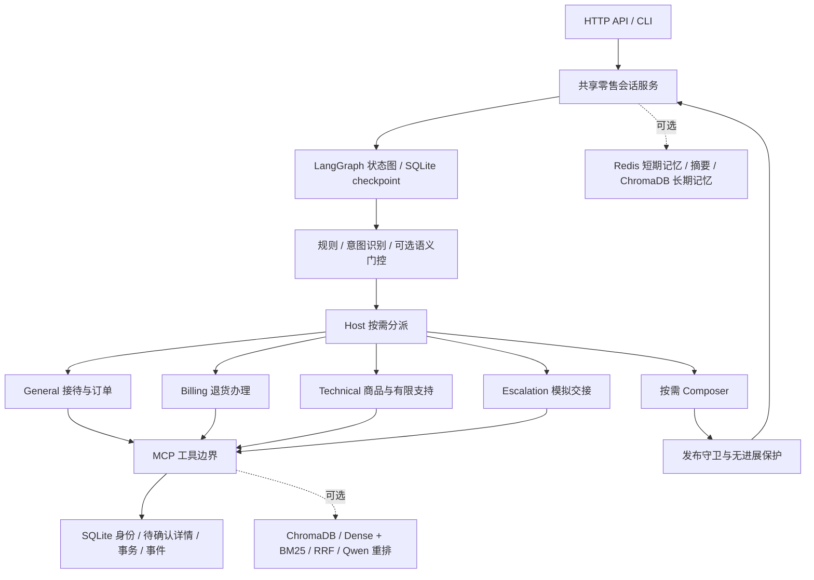

# OrderWeave

**基于 LangGraph、MCP 与受控事务的多 Agent 零售客服系统。**

[English](README.en.md) · [评测方法](evaluation/README.md) · [结果与适用范围](evaluation/RESULTS.md) · [MIT](LICENSE)

OrderWeave 将意图识别、按需角色协作、订单工具和可恢复状态图连接到同一条客服链路。项目重点是多轮办理：识别用户需求，核对身份和订单，展示完整退货详情，等待用户确认，再由服务端提交并记录结果。

公开代码面向研究、学习和本地演示。订单来自使用者自行准备的虚构沙箱；退货申请不等于真实退款，人工交接仅为模拟记录。

## 功能

- **统一入口**：FastAPI HTTP API 与交互式 CLI 共用零售服务；默认 `multi + langgraph`，保留单 Agent 和 legacy 回退。
- **按需协作**：general、technical、billing、escalation 四角色；只有主执行者可执行身份绑定、准备、提交和交接，辅助角色只读。
- **可恢复办理**：SQLite checkpoint 保存工作图；退货详情展示后通过 Interrupt／Resume 等待新用户消息，修改后重新确认。
- **受控工具调用**：真实 stdio MCP 子进程；服务端根据会话身份、已展示详情和本轮消息校验授权，提供事务、防重和未知结果保护。
- **分层识别与知识检索**：规则、LLM 与可选本地语义门控；可选 Dense + BM25 + RRF 融合检索及 Qwen 本地重排。
- **可观察性**：按阶段记录工具轨迹、路由、守卫和预算；可选 Redis／ChromaDB 分层记忆与 Prometheus 监控。

## 架构



图状态负责推进流程，Store 负责业务授权。模型输出、历史摘要、客户端 `user_id` 和分类结果都不能代替用户确认。断点恢复也不会自动重放不确定的写操作。

## 算法与控制机制

| 模块 | 实现 | 边界 |
| --- | --- | --- |
| 意图与路由 | 规则优先级、LLM结构化分类、多源融合；六类零售意图映射到四角色 | 分类不绑定身份、不授权交易 |
| 可选本地语义路径 | Qwen3文档向量、岭回归线性头；分数、间隔、同类参考相似度与任务状态共同门控 | 分数不是正确概率；需要外部校准工件，缺失时走原识别路径 |
| 混合检索 | ChromaDB Dense、BM25（k1=1.2、b=0.75）、等权RRF（常数60） | 知识仅作说明，不提供业务状态或交易授权 |
| 本地重排 | Qwen3-Reranker，按最后位置的yes/no相关性分数排序；独立进程隔离依赖 | 需要外部权重，缓存不符时报错，不隐式下载 |
| 事务与恢复 | 准备→原样展示→后续确认→事务提交；参数一致、防重、事件与checkpoint恢复 | 取消待确认退货不等于取消订单；结果未知时不盲重试 |
| 发布守卫 | 对照本轮本人订单、清单、金额和事件；无法核实则具体澄清 | 有限格式校验，不是完整自由文本语义审计 |
| 无进展保护 | 同一事实下连续两轮守卫回退明确失败；新事实或正常通过可恢复 | 失败仍保留为失败，不通过截短会话提高分数 |
| 记忆 | 可选Redis工作记忆与摘要、ChromaDB情景记忆和画像；独立SQLite保存有限可见对话 | 画像默认关闭；历史不提供身份或提交授权 |

## 业务流程展示

以下是交互流程说明，不是在线服务录屏或新的模型评测记录。

```text
用户：想退回某件已送达商品。
系统：请提供本人邮箱，或姓名和邮编。
用户：提供外部沙箱中的身份信息。
系统：通过工具核对身份、查询本人订单，询问商品与退款去向。
用户：指定商品和合法退款去向。
系统：准备并展示订单号、商品、数量、预计金额、去向及操作编号。
用户：在下一轮明确确认；也可以修改、取消待确认申请或要求人工。
系统：服务端校验后提交，反馈“已申请退货”；不宣称退款已经到账。
```

已展示详情可以在服务重启后继续确认；同一确认不能导致重复写入。缺少退款去向、存在附加条件或改口时，系统需要补充信息或重新展示，不能直接提交。

## 运行环境

- Windows、Python 3.12、[uv](https://docs.astral.sh/uv/)。其他系统未作同等验证。
- 支持 Anthropic Messages 协议的模型服务。真实请求需要使用者自己的凭证与明确预算。
- **轻量业务入口**：仅需外部订单种子、政策和模型服务；不需要Redis、ChromaDB或本地Qwen。
- **扩展资料链**：另外需要Redis、ChromaDB、对应本地模型及知识／语义工件。

### 1. 安装

在仓库根目录执行：

```powershell
uv python find 3.12
uv sync --locked --group dev
Copy-Item .env.example .env
```

本仓库**不分发任何评测数据集、运行订单、知识资料、参考向量或模型权重**。公开源代码不会自动恢复维护者的私有评测环境。

### 2. 显式准备外部运行资料

准备工具只在指定 `--download` 时联网，获取固定提交的τ²-bench虚构订单、政策及其LICENSE，并校验SHA-256：

```powershell
uv run python -m evaluation.prepare_assets --download
# 已有合法资料时，只做本地核对，不联网：
uv run python -m evaluation.prepare_assets
```

默认目录为 `data/retail-assets/`，受Git忽略规则保护。也可以自行获取相同版本的文件，通过 `--directory` 指定位置并同步修改环境变量。工具不下载任务、gold、知识集或模型。

上游为 [τ²-bench固定提交](https://github.com/sierra-research/tau2-bench/tree/fc0055dc4e0a316c3f83133267fbd6faaa770992)。这些资源保留原许可证，详见[第三方说明](THIRD_PARTY_NOTICES.md)。

### 3. 配置模型与预算

编辑本地 `.env`：

```dotenv
ANTHROPIC_API_KEY=填写自己的凭证
ANTHROPIC_BASE_URL=填写兼容服务地址
LLM_MODEL=填写服务接受的模型ID
RETAIL_INPUT_CNY_PER_MTOK=填写当前输入费率
RETAIL_OUTPUT_CNY_PER_MTOK=填写当前输出费率
RETAIL_BUDGET_CNY=1
```

费率单位为人民币／百万token，须按实际供应商核对。模板故意不预填模型价格；缺少有效费率时拒绝启动。预算按请求上界预留并记录usage，不等于供应商账单，也不保证同一预算在所有模型上完成同样轮数。

模板默认关闭知识、外部记忆和语义快速路径，使用新的本地SQLite业务库与checkpoint。请勿将真实客户信息用于这个演示沙箱。

### 4. 启动API或CLI

```powershell
# API，默认只绑定127.0.0.1:8000
uv run python -m api.main

# 或在另一个独立运行中使用CLI
uv run python -m api.main --cli
```

API启动后访问 `http://127.0.0.1:8000/docs` 查看交互文档：

```powershell
Invoke-RestMethod http://127.0.0.1:8000/health
$body = @{ message = "你好，我想申请退货"; user_id = "demo-client"; conv_id = "demo-conversation" } | ConvertTo-Json
Invoke-RestMethod http://127.0.0.1:8000/chat -Method Post -ContentType "application/json; charset=utf-8" -Body ([Text.Encoding]::UTF8.GetBytes($body))
```

后续轮次使用相同的 `user_id`／`conv_id`；身份信息和订单内容从你本地的外部种子中取得。改变会话标识不会授权访问其他人的订单。

| 接口 | 用途 |
| --- | --- |
| `GET /health` | 当前运行模式、工具与预算状态 |
| `POST /chat` | 多轮客服入口 |
| `GET /trace/tool/{request_id}` | 指定请求的工具与控制轨迹 |
| `GET /skills` | 已加载Skills |
| `GET /monitor`、`GET /metrics` | 监控；是否可用取决于运行模式和配置 |
| `POST /search` | 可选知识检索；轻量模式未启用 |

## 可选扩展配置

| 参数 | 默认／说明 |
| --- | --- |
| `RETAIL_AGENT_MODE` | `multi`；可设`single` |
| `RETAIL_WORKFLOW_MODE` | `langgraph`；可设`legacy` |
| `RETAIL_ENABLE_MEMORY` | 模板为`false`；启用需Redis、ChromaDB及本地记忆编码缓存 |
| `RETAIL_ENABLE_KNOWLEDGE` | 模板为`false`；启用需与现有校验约定一致的本地知识资料 |
| `RETAIL_SEMANTIC_ROUTING` | 模板为`false`；启用需外部语义工件和匹配的Qwen编码器 |
| `RETAIL_SEMANTIC_MODEL_PATH` | 外部分类头与参考向量文件；本仓库不附带 |
| `RETAIL_EMBEDDING_MODEL` | `qwen`，也支持`minilm` |
| `RETAIL_RERANKER_MODEL` | `qwen`，可显式选`llm`；后者可能增加费用 |
| `RETAIL_RETRIEVAL_MODE` | `hybrid`、`dense`或`bm25` |
| `RETAIL_SUPPORT_ENABLED` | `false`；有限技术支持需额外匹配资料，不是通用故障处理 |

需要外部服务时显式启动：

```powershell
docker compose up -d redis chromadb
# 停止而不删除数据卷：
docker compose stop
```

Redis使用6380端口，ChromaDB使用8002端口。compose保留既有`agent-ecommerce-*`容器／卷名以兼容本地部署。记忆使用MiniLM缓存，零售RAG可使用Qwen；二者并非同一个索引或缓存。不要在缺少资料时直接打开全部开关。

Qwen推理在独立环境运行，主环境依赖保持锁定：

```powershell
uv venv data/embedding-env --python 3.12
uv pip sync evaluation/embedding_requirements.lock --python data/embedding-env/Scripts/python.exe --extra-index-url https://download.pytorch.org/whl/cpu
```

按官方模型卡自行下载 [Embedding](https://huggingface.co/Qwen/Qwen3-Embedding-0.6B) 和 [Reranker](https://huggingface.co/Qwen/Qwen3-Reranker-0.6B)。本地目录分别为 `data/models/qwen3-embedding-0.6b` 和 `data/models/qwen3-reranker-0.6b`；固定revision及逐文件哈希见两个生产模块的`REVISION`／`MODEL_FILES`，缺少或不符会报错。模型权重须为这些固定版本，运行时不联网下载或执行模型仓库代码。

显式下载固定模型文件的示例（会联网，不会调用付费模型）：

```powershell
.\data\embedding-env\Scripts\python.exe -c "from huggingface_hub import snapshot_download; snapshot_download('Qwen/Qwen3-Embedding-0.6B', revision='97b0c614be4d77ee51c0cef4e5f07c00f9eb65b3', local_dir='data/models/qwen3-embedding-0.6b', allow_patterns=['config.json','model.safetensors','tokenizer.json','tokenizer_config.json','README.md'])"
.\data\embedding-env\Scripts\python.exe -c "from huggingface_hub import snapshot_download; snapshot_download('Qwen/Qwen3-Reranker-0.6B', revision='e61197ed45024b0ed8a2d74b80b4d909f1255473', local_dir='data/models/qwen3-reranker-0.6b', allow_patterns=['config.json','model.safetensors','tokenizer.json','tokenizer_config.json','README.md'])"
# 若启用分层记忆，另行显式准备其MiniLM缓存：
uv run python -c "from mcp.knowledge_base import _ProjectEmbeddingFunction; _ProjectEmbeddingFunction()._download_model_if_not_exists()"
```

知识资料和语义参考工件未分发，因此历史完整资料链的结果无法仅凭本仓库复现。可以先使用轻量业务入口；通用客服模式`RETAIL_MODE=false`另外支持自行导入知识，仍需完整的外部服务与编码缓存。

## 评测结果

| 能力 | 历史结果 | 测试范围 |
| --- | --- | --- |
| 六类意图 | Macro-F1 **0.9917**，119/120正确 | 150条自建回归集中的120条意图计分样本；样本参与过修复诊断 |
| 四角色路由 | **99.30%**，142/143正确 | 同一150条回归集中的143条角色计分样本 |
| 事务与恢复 | **10/10**场景通过 | 真实SQLite／checkpoint／MCP＋Fake模型的工程契约验证 |
| 能力内τ-retail | **92.31%**，36/39严格成功；10/13题三次均成功 | 单模型deepseek-flash，13道原题×3次，公开虚构沙箱 |

τ结果由v5中断后分两批完成，任务51重新开始会话，保留3个失败；不是全量τ基准、独立盲测或线上成功率。最新守卫修复完成后，仅做离线验证，不能将这些历史数字归为修后新成绩。历史完整本地检查为804项通过；公开包只包含不依赖私有资料的测试子集。

详细分母与限制见[结果说明](evaluation/RESULTS.md)。本仓库不提供支持这些结果的逐条数据、gold、请求、对话或数据库；不能宣称一键重现历史分数。

## 本地测试与评测

干净发布目录中的公开测试子集已本地通过139项，无外网尝试；该计数与历史804项完整本地检查不同。

```powershell
# 公开的无数据、零模型测试
uv run --locked python -m pytest tests -q

# 对自行准备的私有预测记录汇总，文件不进入Git
uv run python -m evaluation.score_results --kind task --input data/my-run/results.jsonl --planned 39
```

意图、角色、恢复和任务会话的输入格式、固定分母、错误／未运行记录要求见[评测方法](evaluation/README.md)。汇总工具不执行模型、业务工具或官方Judge，不能代替实际验收。

## 目录

```text
api/          HTTP API与CLI
agents/       Host、四角色、共享服务、状态图与发布守卫
core/         意图识别、可选语义路由、Skills加载
mcp/          stdio工具服务、SQLite、检索和本地模型适配
memory/       分层记忆
monitor/      监控与指标
evaluation/   必要评测组件、外部资产准备、方法与结果摘要
skills/       运行时业务Skills
tests/        不依赖私有数据的公开检查
```

## 使用边界与贡献

本地沙箱不执行真实支付、退款、邮件、快递标签或真人接入。API没有生产级登录／RBAC，CORS配置面向本地使用；不要直接暴露到公网。有限模板校验不覆盖所有自然语言含义，记忆也不是授权来源。

提交修改前运行公开测试。复现问题时提供最小的脱敏输入、配置与错误说明，不提交密钥、客户信息、运行数据库、模型缓存或数据集。公开文档仅保留本README、英文版、必要许可声明，以及评测方法和结果摘要；开发计划、任务记录和过程性报告不属于发行物。

## 许可证

[MIT](LICENSE)。外部数据与模型遵守各自条款，见[第三方说明](THIRD_PARTY_NOTICES.md)。
