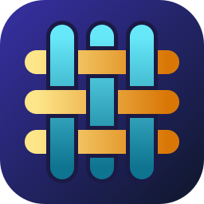
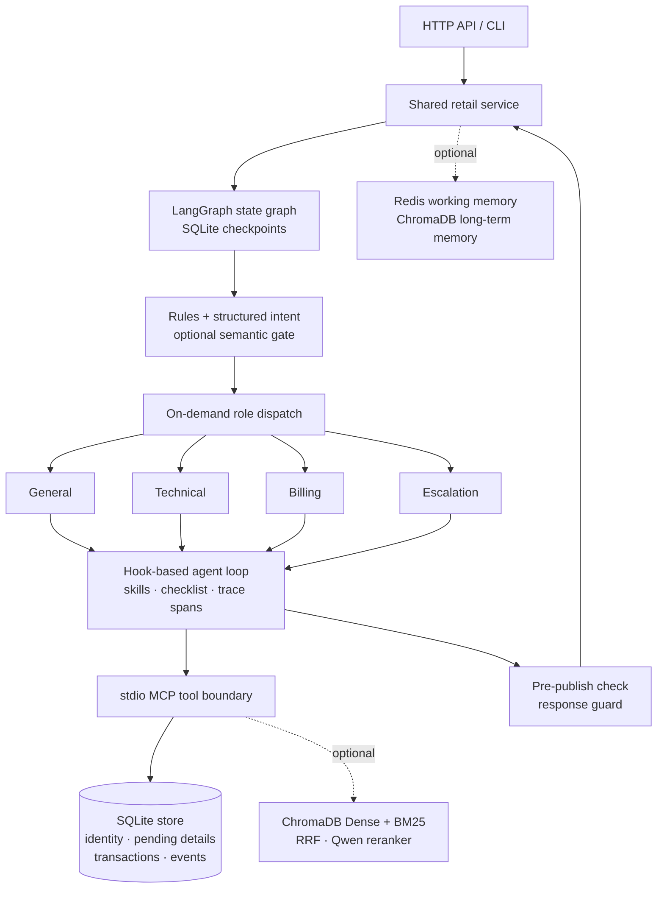
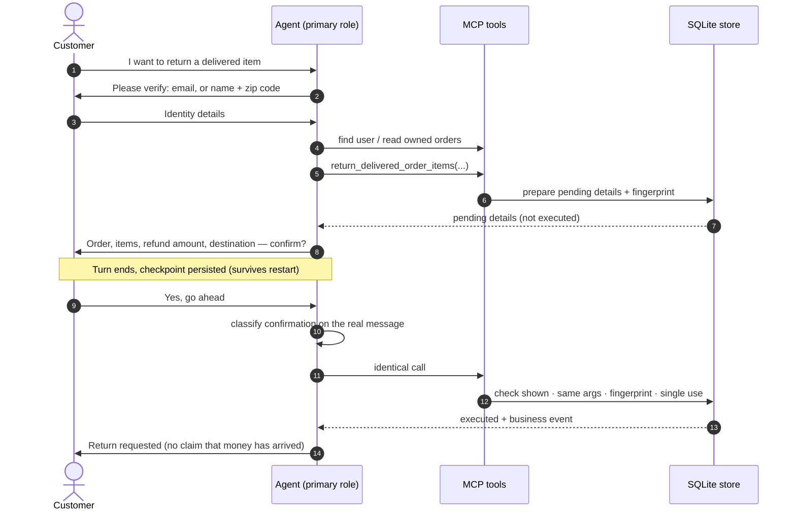

<div align="center">



# OrderWeave

**A stateful multi-agent retail support agent with two-phase confirmed writes, built on LangGraph and MCP.**

English · [简体中文](README.zh-CN.md)

<p>
  
  
  
  
  
  
  
  <br>
  
  
  
  
  
  
  <br>
  
  
  
</p>

[Highlights](#-highlights) ·
[Results](#-evaluation-results) ·
[Architecture](#%EF%B8%8F-architecture) ·
[Quick start](#-quick-start) ·
[Web console](#%EF%B8%8F-web-console) ·
[Configuration](#%EF%B8%8F-configuration) ·
[Evaluation](#-reproducing-the-evaluation)

</div>

---

## 📖 Overview

OrderWeave is an e-commerce customer-service agent that actually **changes orders**, not just answers questions. It handles a conversation end to end: understand the request, verify the customer's identity, read the orders they own, show complete server-generated pending details, wait for the customer to confirm in a later message, and only then execute the change behind server-side checks.

It supports all seven write actions of the [τ²-bench](https://github.com/sierra-research/tau2-bench) retail domain:

| Order state | Actions |
| --- | --- |
| Pending order | Cancel · Modify items · Modify shipping address · Modify payment method |
| Delivered order | Return · Exchange |
| Account | Modify default address |

On the full τ²-bench retail benchmark (114 tasks × 3 trials) it reaches **pass^1 0.822** while carrying out **503 writes with 0 unconfirmed and 0 duplicate**.

> [!NOTE]
> OrderWeave is for research, learning and local demos. Orders come from a fictional sandbox you prepare yourself; a "return requested" is not a real refund, and a handoff to a human is only a simulated record.

## ✨ Highlights

- **🔐 Two-phase writes, enforced by the server.** The first call of any write tool only prepares and displays pending details. An identical call after the customer confirms in a *later* message executes it. A structured classifier judges the confirmation from the real user message; execution re-checks display state, identical arguments, a data fingerprint and single use. Model output, summaries, client `user_id` and intent labels can never authorize a write.
- **🧵 Recoverable LangGraph workflow.** SQLite checkpoints plus Interrupt/Resume let a conversation wait for confirmation across turns and even across service restarts. Changed details require a fresh confirmation; uncertain writes are never blindly replayed.
- **🤝 On-demand multi-agent collaboration.** General, technical, billing and escalation roles share one hook-based agent loop. Only the primary role may bind identity, call write tools or record a handoff; supporting roles are read-only.
- **🛠️ A real MCP tool boundary.** Tools run in a stdio MCP subprocess with server-side identity, ownership, transaction, deduplication and unknown-result protection. Business semantics are ported from the official τ² tools, and reference replays match the official database hash.
- **🧠 Compiled context.** An append-only log of every message, rendered per role with a stable prefix first and the per-turn state snapshot last (friendly to provider prefix caching, 86.5% input cache hits). Over budget, old tool results become re-queryable references and earlier turns an anchored summary, both persisted.
- **📚 Policy as on-demand skills.** Each action section of the fixed policy becomes a skill. The prompt lists only names and descriptions; write tools stay locked by a hook until the agent loads the matching skill with `load_skill`.
- **📝 Request checklist.** Each turn the model proposes the changes the customer asked for; code checks quotes verbatim and derives progress only from business events. Before a transfer to a human with handleable requests still open, the agent reminds the customer once.
- **🛡️ Pre-publish check and response guard.** Drafts are checked against current order facts, items, amounts and session events; problems return as structured feedback for one rewrite, and the publish guard stays as the last line.
- **🖥️ Live web console.** Chat on the left, the sandbox database in the middle, and the agent's path on the right: the LangGraph skeleton lights up as the turn walks it, and every node, model call, tool call and guard check opens to its prompt, output, tokens and cost. Each write shows up as a field-level before → after diff. Recorded sessions replay offline with no model calls.
- **📊 Built-in evaluation harness.** One command runs the official τ² user simulator and DB/NL scoring with per-session databases, a shared cost ledger, resumable runs, paired task-bootstrap comparisons and trace viewing.

## 📈 Evaluation results

### Full τ²-bench retail (2026-11-04)

| Metric | Result |
| --- | --- |
| **pass^1** | **0.822** (95% CI 0.763–0.874, task bootstrap) |
| pass^2 / pass^3 | 0.734 / 0.667 |
| Sessions | 114 tasks × 3 = 342, all valid, 281 successes; 1 ended by agent error |
| Write safety | 503 writes, all displayed first and executed after a later confirmation; **0 unconfirmed, 0 duplicate** |
| Cost | ≈ CNY 0.046 per session (system under test + user simulator + judge) |
| Latency | Turn P50 5.9 s / P95 11.2 s; 86.5% system input cache hits |

<details>
<summary><b>Setup and how it was measured</b></summary>

- τ²-bench pinned at [`fc0055d`](https://github.com/sierra-research/tau2-bench/tree/fc0055dc4e0a316c3f83133267fbd6faaa770992), all 114 tasks of the retail base split, official user simulator and database plus natural-language assertion scoring.
- The system under test, the user simulator and the judge all use `deepseek-flash` with thinking disabled; default configuration (multi-agent, compiled context, on-demand skills, pre-publish revision, request checklist).
- No task is excluded. 15 tasks whose official reference actions raise errors are scored as the official harness does.
- The LLM judge agreed with blind labels from another model family on 0.92 of 50 assertions.
- This is a single run, not an online success rate.

</details>

### Progress over development

Each change was paired with the previous version on fixed small suites (same tasks and seeds, task-bootstrap 95% CI) before the final full runs:

| Change | Suite | Before → After |
| --- | --- | --- |
| Compiled full-history context + guard checks against live order records | τ-mini (40 stratified tasks) | 0.65 → 0.79 |
| Recap claims checked against all session events | τ-mini | 0.725 → 0.90 |
| Pre-publish check and one revision | English adversarial holdout (19 tasks) | 0.684 → 1.00 |
| No dead-ends on calls that never ran + request checklist | Full τ² retail | 0.781 → **0.822** (pass^3 0.614 → 0.667) |

Negative results are kept too: enabling model thinking, the temporal fact ledger, claim-level guard checks, a variant-filter tool and self-evolved skill candidates showed no significant gain (or regressed) and are off by default or not shipped.

## 🏗️ Architecture



The graph advances the workflow; the store owns business authorization.

### How a write is carried out



<details>
<summary><b>Components and their boundaries</b></summary>

| Component | Implementation | Boundary |
| --- | --- | --- |
| Intent and routing | Rule priorities, structured LLM classification and multi-source fusion; six retail intents mapped to four roles | Classification never binds identity or authorizes a transaction |
| Optional semantic gate | Qwen3 embeddings + ridge-regression head, gated by score, margin, reference similarity and task state | Scores are not correctness probabilities; needs external calibrated artifacts |
| Hybrid retrieval | ChromaDB Dense, BM25 (k1=1.2, b=0.75), equal-weight RRF (k=60), local Qwen3-Reranker in a separate process | Knowledge explains policy; it never establishes business state |
| Transactions | prepare → display unchanged details → per-turn confirmation → identical call executes; fingerprint, dedup, events, checkpoints | Withdrawing pending details is not cancelling an order; unknown results are not retried blindly |
| Context compilation | Full message log per role; state snapshot last; persisted reference/summary compaction; usage-calibrated token estimates | History informs the model only; `RETAIL_CONTEXT_MODE=window` keeps the old two-turn window |
| On-demand skills | Policy split by section into `skills/retail-*`; the split concatenates back to the original text | Skills provide text only; `RETAIL_SKILL_MODE=inline` keeps the whole policy in the prompt |
| Request checklist | Model-proposed items with verbatim quotes and order ids validated by code; progress from business events | Drives reminders and routing only; an insisting customer is still transferred |
| Response guard | Checks owned-order facts, items, amounts and events; asks specific questions when verification fails | Limited predicates, not a full semantic audit of free text |
| Agent loop hooks | `pre_model` / `pre_tool` / `post_tool` / `on_tool_error` / `stop_response`; every model and tool call is a replayable trace span | Hooks check invariants; they cannot authorize writes |
| Memory | Optional Redis working memory and summaries, ChromaDB episodic/profile memory | Off by default; never a source of identity or confirmation |

</details>

## 🚀 Quick start

### Requirements

- Windows, Python 3.12 and [uv](https://docs.astral.sh/uv/) (other platforms have not been validated equally)
- An Anthropic Messages-compatible model endpoint and your own API key

The lightweight business mode below needs **no** Redis, ChromaDB or local models.

### 1. Install

```powershell
git clone https://github.com/zaughterCoding/OrderWeave.git
cd OrderWeave
uv sync --locked --group dev
Copy-Item .env.example .env
```

### 2. Prepare the sandbox assets

The repository ships no datasets, orders or model weights. This fetches the fictional retail seed, policy and license from the pinned τ²-bench commit and verifies SHA-256 hashes (network is used only with `--download`):

```powershell
uv run python -m evaluation.prepare_assets --download
# Verify existing local assets offline:
uv run python -m evaluation.prepare_assets
```

Files go to `data/retail-assets/` (ignored by Git).

### 3. Configure the model and budget

Edit `.env`:

```dotenv
ANTHROPIC_API_KEY=your-own-key
ANTHROPIC_BASE_URL=your-compatible-endpoint
LLM_MODEL=your-provider-model-id
RETAIL_INPUT_CNY_PER_MTOK=current-input-price
RETAIL_OUTPUT_CNY_PER_MTOK=current-output-price
RETAIL_BUDGET_CNY=1
```

Prices are CNY per million tokens and must match your provider; startup rejects missing or invalid rates. The built-in ledger reserves an upper bound per request and stops at the budget — it is not a provider invoice.

### 4. Run

```powershell
# HTTP API on 127.0.0.1:8000 (explorer at /docs)
uv run python -m api.main

# Or an interactive CLI
uv run python -m api.main --cli
```

```powershell
$body = @{ message = "Hi, I want to return an item"; user_id = "demo"; conv_id = "demo-1" } | ConvertTo-Json
Invoke-RestMethod http://127.0.0.1:8000/chat -Method Post -ContentType "application/json; charset=utf-8" -Body ([Text.Encoding]::UTF8.GetBytes($body))
```

Keep `user_id` and `conv_id` unchanged across turns. Take sandbox identities from your local seed; changing client identifiers does not grant access to anyone else's orders.

| Endpoint | Purpose |
| --- | --- |
| `GET /health` | Active mode, tools and budget state |
| `POST /chat` | Multi-turn support conversation |
| `GET /trace/tool/{request_id}` | Tool and control traces of one request |
| `GET /skills` | Loaded skills |
| `GET /monitor`, `GET /metrics` | Monitoring and Prometheus metrics |
| `POST /search` | Optional knowledge retrieval (off in lightweight mode) |

## 🖥️ Web console

A three-pane console for watching the agent work: **conversation**, **database** and **trace**.

- **Conversation**: four preset sandbox scenarios (cancel, return, exchange, address update) with suggested messages, or type your own. Pending confirmations are flagged.
- **Database** (read-only): the bound customer, their orders and the products involved, plus a *session state* tab with pending actions, confirmation decisions, the request checklist and business events. Every write is highlighted as before → after; snapshots of each turn can be revisited, and the whole sandbox can be searched.
- **Trace**: the LangGraph skeleton for the chosen mode (single / multi-agent) highlights the path the turn took, and an execution tree grows in real time — workflow nodes → roles → model calls, tools, hooks and the publish guard. Each module is collapsed; open it to see the system prompt (folded), recent messages, output, token usage, cache hits and cost.
- **Replay**: five recorded sessions ship in `web/replays/`; every live session is also recorded to `data/web-sessions/<id>/events.jsonl` (local project paths are redacted) and can be replayed later.

Each live session copies the sandbox seed into its own database and runs the same lightweight profile as the evaluation (no Redis, ChromaDB or local models), with a per-session budget of CNY 0.5. A two-turn scenario costs roughly CNY 0.005–0.01 with DeepSeek.

```powershell
# Requires Node.js 18+ once, to build the frontend
cd web; npm ci; npm run build; cd ..

# Console on http://127.0.0.1:8010 (replay works without an API key)
uv run python -m api.web_console
```

For frontend development, run the backend as above and `npm run dev` in `web/` (Vite on port 5173, proxying `/api`).

| Endpoint | Purpose |
| --- | --- |
| `POST /api/web/sessions` | New sandbox session (`mode`: `single` / `multi`) |
| `POST /api/web/sessions/{id}/turns` | Send a message; the turn streams back as server-sent events |
| `GET /api/web/sessions/{id}/db?q=` | Related entities, or search the whole sandbox |
| `GET /api/web/sessions/{id}/snapshots/{turn}` | Database snapshot after a turn |
| `GET /api/web/replays` | Built-in and recorded sessions |

## ⚙️ Configuration

| Setting | Default | Notes |
| --- | --- | --- |
| `RETAIL_AGENT_MODE` | `multi` | `single` runs one agent (≈30% cheaper, slightly lower success) |
| `RETAIL_WORKFLOW_MODE` | `langgraph` | `legacy` is a fallback |
| `RETAIL_CONTEXT_MODE` | `compiled` | `window` keeps the old two-turn window for comparison |
| `RETAIL_CONTEXT_BUDGET_TOKENS` | `32000` | Above this estimate, history is compacted and persisted |
| `RETAIL_SKILL_MODE` | `on_demand` | `inline` keeps the whole policy in the prompt |
| `RETAIL_PUBLISH_REVISION` | `true` | Check the draft before publishing and revise once |
| `RETAIL_REQUEST_PLAN` | `true` | Session request checklist (needs `compiled`) |
| `RETAIL_TASK_FACTS` | `false` | Temporal fact ledger; no significant gain, ≈30% more cost |
| `RETAIL_ENABLE_MEMORY` | `false` | Needs Redis, ChromaDB and a local MiniLM cache |
| `RETAIL_ENABLE_KNOWLEDGE` | `false` | Needs your own knowledge collection |
| `RETAIL_SEMANTIC_ROUTING` | `false` | Needs external semantic artifacts and a Qwen encoder |
| `RETAIL_RETRIEVAL_MODE` | `hybrid` | `dense` or `bm25` |

<details>
<summary><b>Optional services and local models</b></summary>

```powershell
# Redis on 6380, ChromaDB on 8002
docker compose up -d redis chromadb
docker compose stop
```

Qwen inference runs in a separate environment so the main dependencies stay locked:

```powershell
uv venv data/embedding-env --python 3.12
uv pip sync evaluation/embedding_requirements.lock --python data/embedding-env/Scripts/python.exe --extra-index-url https://download.pytorch.org/whl/cpu
```

Download [Qwen3-Embedding-0.6B](https://huggingface.co/Qwen/Qwen3-Embedding-0.6B) and [Qwen3-Reranker-0.6B](https://huggingface.co/Qwen/Qwen3-Reranker-0.6B) yourself into `data/models/qwen3-embedding-0.6b` and `data/models/qwen3-reranker-0.6b`. The modules pin `REVISION` and `MODEL_FILES`; mismatched files fail validation, and runtime never downloads models or runs model-repository code.

```powershell
.\data\embedding-env\Scripts\python.exe -c "from huggingface_hub import snapshot_download; snapshot_download('Qwen/Qwen3-Embedding-0.6B', revision='97b0c614be4d77ee51c0cef4e5f07c00f9eb65b3', local_dir='data/models/qwen3-embedding-0.6b', allow_patterns=['config.json','model.safetensors','tokenizer.json','tokenizer_config.json','README.md'])"
.\data\embedding-env\Scripts\python.exe -c "from huggingface_hub import snapshot_download; snapshot_download('Qwen/Qwen3-Reranker-0.6B', revision='e61197ed45024b0ed8a2d74b80b4d909f1255473', local_dir='data/models/qwen3-reranker-0.6b', allow_patterns=['config.json','model.safetensors','tokenizer.json','tokenizer_config.json','README.md'])"
```

</details>

## 🧪 Reproducing the evaluation

```powershell
# Offline tests: no datasets, no real models, no network
uv run --locked python -m pytest tests -q
```

The harness in `evaluation/harness/` builds the system under test from the production runtime and reuses the official τ² user simulator and DB/NL scoring. Each session runs in its own subprocess with its own database, checkpoint and ledger; re-running a `run-id` only fills in missing sessions.

1. Create a separate τ environment: `uv venv .venv-tau --python 3.12`, then install `tau2` from `git+https://github.com/sierra-research/tau2-bench@fc0055dc4e0a316c3f83133267fbd6faaa770992`.
2. Point `HARNESS_TAU_DATA` at a directory containing `tau2/domains/retail/{db.json,policy.md,tasks.json}`.
3. Put model credentials in `.env`.

```powershell
# 14 in-scope tasks × 3 trials, global budget CNY 5
uv run python -m evaluation.harness.run --suite tau-core --trials 3 --run-id my-run --budget-cny 5
```

Real model calls cost money — always set a budget and run a small pilot first. See the [evaluation guide (Chinese)](evaluation/README.md) for suites, paired comparison, judge calibration and the offline aggregator.

## 📂 Project layout

```text
api/          FastAPI app and CLI entry
agents/       Roles, agent loop and hooks, LangGraph workflow, confirmation, guard, checklist
core/         Context engine, intent recognition, semantic routing, skill loader
mcp_tools/    stdio MCP server/client, retail store and domain, retrieval, Qwen adapters
memory/       Conversation memory and temporal fact ledger
monitor/      Performance monitoring and Prometheus metrics
evaluation/   τ² bridge, evaluation harness, metrics, ledger, asset preparation
skills/       Runtime business skills (policy sections + procedures)
tests/        Offline tests without private datasets
web/          React web console and built-in replays
```

## ⚠️ Scope and limitations

- No real payments, refunds, email, shipping labels or live agents — everything runs in a local sandbox.
- The API has no production authentication/RBAC and its CORS targets local use; do not expose it to the public internet.
- Guard predicates are limited and do not verify every natural-language claim; memory is never an authorization source.
- Remaining τ² failures are mostly multi-action reasoning, recalling stale tool results, and user-simulator drift.

## 🤝 Contributing

Run the offline tests before proposing changes. When reporting issues, share minimal sanitized inputs, configuration and errors — never credentials, customer records, runtime databases, model caches or datasets.

## 🙏 Acknowledgements

- [τ²-bench](https://github.com/sierra-research/tau2-bench) by Sierra Research for the retail domain, user simulator and scoring.
- [LangGraph](https://github.com/langchain-ai/langgraph), [Model Context Protocol](https://modelcontextprotocol.io/), [Qwen3](https://huggingface.co/Qwen) and [ChromaDB](https://www.trychroma.com/).

## 📄 License

[MIT](LICENSE). External resources keep their own terms; see [third-party notices](THIRD_PARTY_NOTICES.md).
