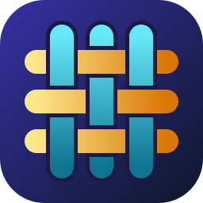
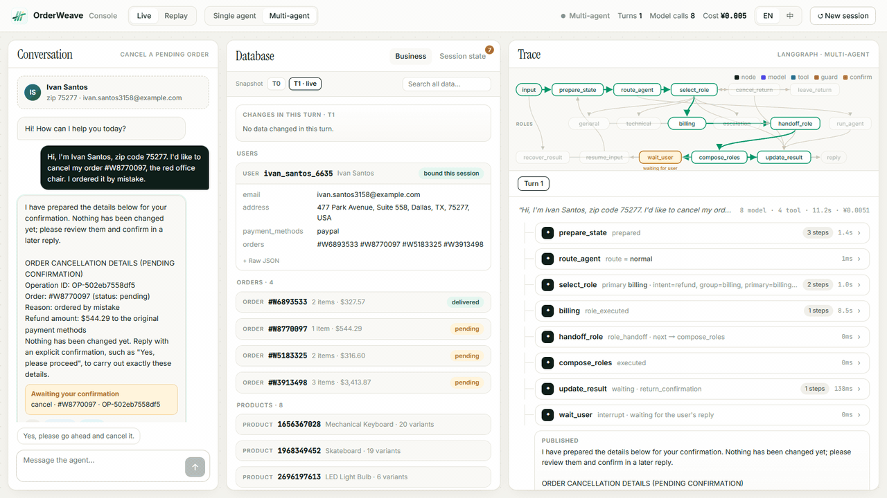
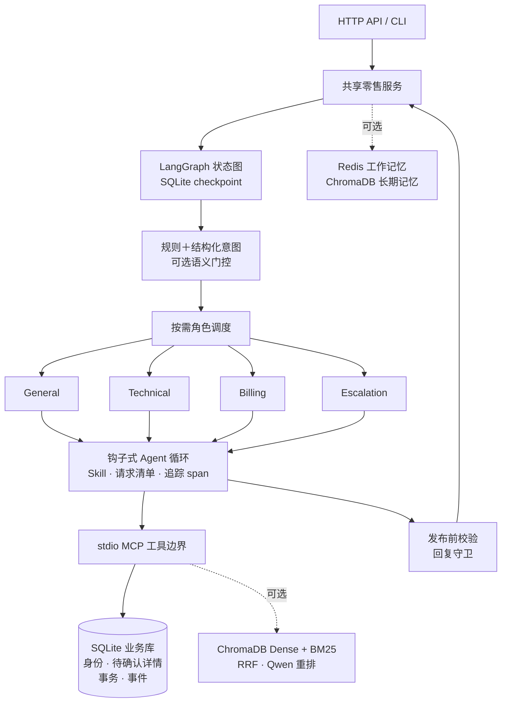
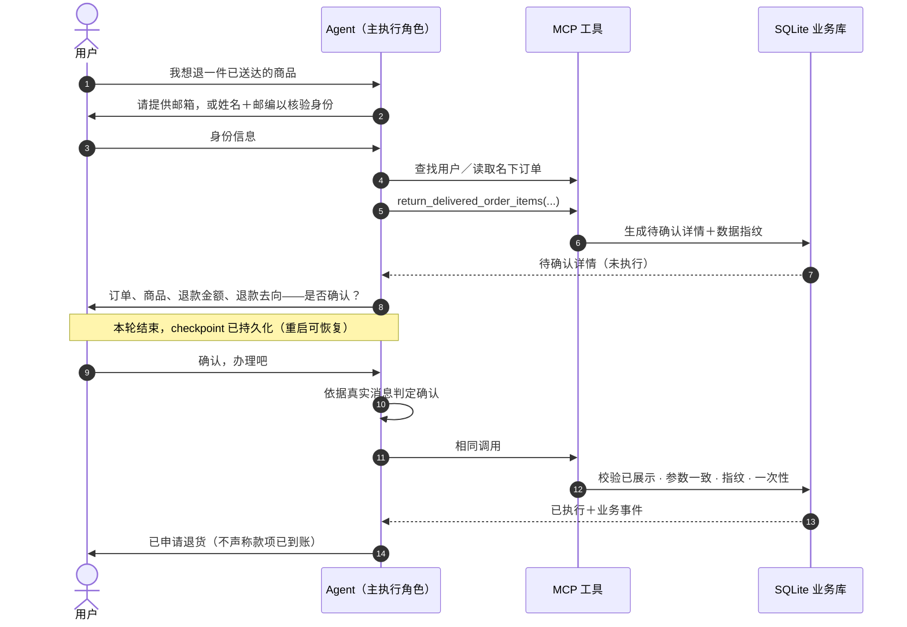

<div align="center">



# OrderWeave

**基于 LangGraph 与 MCP 的有状态多 Agent 零售客服，写操作经两阶段确认后由服务端执行。**

[English](README.md) · 简体中文

<p>
  
  
  
  
  
  
  
  <br>
  
  
  
  
  
  
  <br>
  
  
  
</p>

[亮点](#-亮点) ·
[评测结果](#-评测结果) ·
[架构](#%EF%B8%8F-架构) ·
[快速开始](#-快速开始) ·
[Web 控制台](#%EF%B8%8F-web-控制台) ·
[配置](#%EF%B8%8F-配置) ·
[复现评测](#-复现评测)

<br>



<sub><a href="#%EF%B8%8F-web-控制台">Web 控制台</a>中的一次输入：链路实时走过 LangGraph 工作图，数据库中订单由 <code>pending</code> 变为 <code>cancelled</code> 并记入退款，每次模型调用都可展开查看 prompt 与费用。（真实 DeepSeek 运行，等待时间已压缩。）</sub>

</div>

---

## 📖 简介

OrderWeave 是一个真正**办理订单**、而不只是回答问题的电商客服 Agent。它完整走完一次多轮对话：理解需求 → 核验身份 → 读取用户名下订单 → 展示服务端生成的完整待确认详情 → 等用户在**后续消息**中确认 → 经服务端校验后执行。

支持 [τ²-bench](https://github.com/sierra-research/tau2-bench) retail 领域全部七类写操作：

| 订单状态 | 操作 |
| --- | --- |
| 待处理订单 | 取消 · 修改商品 · 修改收货地址 · 修改支付方式 |
| 已送达订单 | 退货 · 换货 |
| 账户 | 修改默认地址 |

在 τ²-bench retail 全量（114 题 × 3 次）上 **pass^1 达到 0.822**，执行 **503 次写入，未确认写入 0、重复写入 0**。

内置 [Web 控制台](#%EF%B8%8F-web-控制台) 实时展示每一轮：对话本身、沙箱数据库逐字段的变化，以及 Agent 在工作图中的路径和每一步的中间结果。

> [!NOTE]
> 本项目面向研究、学习与本地演示。订单来自使用者自行准备的虚构沙箱；“已申请退货”不等于真实退款，转人工仅为模拟记录。

## ✨ 亮点

- **🔐 服务端强制的两阶段写入**：任一写工具的首次调用只生成并展示待确认详情；用户在后续消息确认后，相同调用才会执行。确认由结构化分类器依据真实用户消息判定；执行时复核展示状态、参数一致、数据指纹与一次性使用。模型输出、摘要、客户端 `user_id` 与意图标签都无法授权写入。
- **🧵 可恢复的 LangGraph 流程**：SQLite checkpoint 配合 Interrupt/Resume，让对话跨轮次、甚至跨服务重启等待确认；详情变化须重新确认，结果不明的写入绝不盲目重放。
- **🤝 按需多 Agent 协作**：general、technical、billing、escalation 四个角色共用一套基于钩子的 Agent 循环；只有主执行角色能绑定身份、调用写工具或记录交接，辅助角色只读。
- **🛠️ 真实的 MCP 工具边界**：工具运行在 stdio MCP 子进程中，服务端负责身份、归属、事务、去重和未知结果保护；业务语义移植自官方 τ² 工具，参考解重放与官方数据库哈希一致。
- **🧠 上下文编译**：追加式记录全部消息，按角色渲染，稳定前缀在前、每轮状态快照在后，适配供应商前缀缓存（输入缓存命中 86.5%）；超出预算时旧工具结果替换为可回查引用、早期轮次替换为锚定摘要，并持久化。
- **📚 政策即按需 Skill**：固定政策按动作章节拆为 Skill，Prompt 只列名称与描述；在 Agent 用 `load_skill` 加载对应 Skill 之前，写工具由钩子锁定。
- **📝 请求清单**：每轮由模型提议用户要求的变更，代码逐字校验引用，进度只由业务事件推出；仍有可办请求未完成就要转人工时，先提醒用户一次。
- **🛡️ 发布前校验与回复守卫**：草稿对照当前订单事实、商品、金额和会话事件检查，问题以结构化反馈交回模型修订一次，发布守卫作为最后防线。
- **🖥️ 实时 Web 控制台**：左侧对话、中间沙箱数据库、右侧 Agent 链路。LangGraph 骨架随本轮执行逐步点亮，每个节点、模型调用、工具调用与守卫检查都可展开查看 prompt、输出、token 与费用；每次写入以字段级“旧值 → 新值”呈现。录制的会话可离线回放，不调用模型。
- **📊 内置评测 harness**：一条命令调用官方 τ² 用户模拟器与 DB／NL 评分，每会话独立数据库、共享费用账本、可断点续跑，支持按题配对 bootstrap 对比与轨迹查看。

## 📈 评测结果

### τ²-bench retail 全量（2026-11-04）

| 指标 | 结果 |
| --- | --- |
| **pass^1** | **0.822**（95% 区间 0.763–0.874，按题 bootstrap） |
| pass^2 / pass^3 | 0.734 / 0.667 |
| 会话 | 114 题 × 3 = 342，全部有效，成功 281；1 个因 Agent 错误结束 |
| 写入安全 | 503 次写入均先展示、后续确认后执行；**未确认 0、重复 0** |
| 成本 | 约 0.046 元／会话（含被测系统、用户模拟器与 Judge） |
| 延迟 | 单轮 P50 5.9 秒／P95 11.2 秒；被测系统输入缓存命中 86.5% |

<details>
<summary><b>评测设置与口径</b></summary>

- τ²-bench 固定提交 [`fc0055d`](https://github.com/sierra-research/tau2-bench/tree/fc0055dc4e0a316c3f83133267fbd6faaa770992)，retail base 全部 114 题，官方用户模拟器、数据库与自然语言断言评分。
- 被测系统、用户模拟器与 Judge 均为 `deepseek-flash`，关闭思考；默认配置（多 Agent、编译上下文、按需 Skill、发布前修订、请求清单）。
- 不排除任何题目；15 道官方参考动作本身报错的题按官方 harness 方式计分。
- LLM Judge 与另一模型家族的盲标在 50 条断言上一致率 0.92。
- 这是一次运行结果，不代表线上成功率。

</details>

### 开发过程中的提升

每项改动都先在固定小样本集上与上一版本配对比较（相同题目与种子，按题 bootstrap 95% 区间），最后再跑全量：

| 改动 | 评测集 | 前 → 后 |
| --- | --- | --- |
| 完整历史上下文编译＋守卫以实时订单记录核对 | τ-mini（40 道分层抽样题） | 0.65 → 0.79 |
| 回顾性说法对照全部会话事件核验 | τ-mini | 0.725 → 0.90 |
| 发布前校验并修订一次 | 英文对抗留出集（19 题） | 0.684 → 1.00 |
| 未执行调用不再让会话陷入死局＋请求清单 | τ² retail 全量 | 0.781 → **0.822**（pass^3 0.614 → 0.667） |

负面结果同样保留：开启模型思考、时序事实账本、声明级守卫核验、变体筛选工具和自进化 Skill 候选均无显著收益（或退步），默认关闭或未合入。

## 🏗️ 架构



状态图推进流程，业务库掌握授权。

### 一次写操作如何执行



<details>
<summary><b>组件与边界</b></summary>

| 组件 | 实现 | 边界 |
| --- | --- | --- |
| 意图与路由 | 规则优先级、结构化 LLM 分类与多源融合；六类零售意图映射到四个角色 | 分类结果不能绑定身份或授权事务 |
| 可选语义门控 | Qwen3 向量＋岭回归线性头，按分数、间隔、参考相似度与任务状态门控 | 分数不是正确率概率；需要外部校准工件 |
| 混合检索 | ChromaDB Dense、BM25（k1=1.2，b=0.75）、等权 RRF（k=60），独立进程本地 Qwen3-Reranker | 知识只解释政策，不确立业务状态 |
| 事务 | 准备 → 展示不变详情 → 逐轮确认判定 → 相同调用执行；指纹、去重、事件、checkpoint | 撤回待确认详情不等于取消订单；未知结果不盲目重试 |
| 上下文编译 | 按角色渲染完整消息日志；状态快照在末尾；引用／摘要压缩持久化；按真实用量校准 token 估计 | 历史只供模型参考；`RETAIL_CONTEXT_MODE=window` 保留旧的两轮窗口 |
| 按需 Skill | 政策按章节拆到 `skills/retail-*`，拼回即为原文 | Skill 只提供文本；`RETAIL_SKILL_MODE=inline` 将完整政策放入 Prompt |
| 请求清单 | 模型提议条目，代码校验逐字引用与订单号；进度来自业务事件 | 只驱动提醒与路由；用户坚持转人工仍会放行 |
| 回复守卫 | 核对名下订单事实、商品、金额与事件；核验失败时追问具体信息 | 谓词有限，不是对自由文本的完整语义审计 |
| Agent 循环钩子 | `pre_model`／`pre_tool`／`post_tool`／`on_tool_error`／`stop_response`；每次模型与工具调用都记为可重放的追踪 span | 钩子只检查不变量，不能授权写入 |
| 记忆 | 可选 Redis 工作记忆与摘要、ChromaDB 情景／画像记忆 | 默认关闭；永远不作为身份或确认依据 |

</details>

## 🚀 快速开始

### 环境要求

- Windows、Python 3.12 与 [uv](https://docs.astral.sh/uv/)（其他平台未经同等验证）
- 兼容 Anthropic Messages 接口的模型服务与你自己的 API Key

下面的轻量业务模式**不需要** Redis、ChromaDB 或本地模型。

### 1. 安装

```powershell
git clone https://github.com/zaughterCoding/OrderWeave.git
cd OrderWeave
uv sync --locked --group dev
Copy-Item .env.example .env
```

### 2. 准备沙箱资产

仓库不分发数据集、订单或模型权重。下面的命令从固定的 τ²-bench 提交获取虚构零售种子数据、政策与许可证，并校验 SHA-256（只有加 `--download` 才联网）：

```powershell
uv run python -m evaluation.prepare_assets --download
# 离线校验已有资产：
uv run python -m evaluation.prepare_assets
```

文件保存在 `data/retail-assets/`（已被 Git 忽略）。

### 3. 配置模型与预算

编辑 `.env`：

```dotenv
ANTHROPIC_API_KEY=your-own-key
ANTHROPIC_BASE_URL=your-compatible-endpoint
LLM_MODEL=your-provider-model-id
RETAIL_INPUT_CNY_PER_MTOK=current-input-price
RETAIL_OUTPUT_CNY_PER_MTOK=current-output-price
RETAIL_BUDGET_CNY=1
```

单价单位为“元／百万 token”，须与供应商一致；缺失或无效时启动即报错。内置账本按每次请求的上限预留、达到预算即停止，它不是供应商账单。

### 4. 运行

```powershell
# HTTP API，监听 127.0.0.1:8000（/docs 为接口调试页）
uv run python -m api.main

# 或交互式 CLI
uv run python -m api.main --cli
```

```powershell
$body = @{ message = "Hi, I want to return an item"; user_id = "demo"; conv_id = "demo-1" } | ConvertTo-Json
Invoke-RestMethod http://127.0.0.1:8000/chat -Method Post -ContentType "application/json; charset=utf-8" -Body ([Text.Encoding]::UTF8.GetBytes($body))
```

多轮对话保持 `user_id` 与 `conv_id` 不变。沙箱身份信息从本地种子数据中获取；修改客户端标识并不能访问他人订单。

| 接口 | 用途 |
| --- | --- |
| `GET /health` | 当前模式、工具与预算状态 |
| `POST /chat` | 多轮客服对话 |
| `GET /trace/tool/{request_id}` | 单次请求的工具与控制轨迹 |
| `GET /skills` | 已加载的 Skill |
| `GET /monitor`、`GET /metrics` | 监控与 Prometheus 指标 |
| `POST /search` | 可选知识检索（轻量模式下关闭） |

## 🖥️ Web 控制台

三列控制台，直观观察 Agent 如何工作：**对话**、**数据库**、**链路**。

- **对话**：四个预置沙箱场景（取消、退货、换货、改地址）及建议话术，也可自由输入；待确认的操作会醒目标出。
- **数据库**（只读）：已绑定的用户、其订单与涉及商品；“会话状态”页展示待确认动作、确认判定、请求清单与业务事件。每次写入以“旧值 → 新值”高亮，可回看每轮快照，也可搜索整个沙箱。
- **链路**：按所选模式（单 / 多智能体）显示 LangGraph 骨架并点亮本轮走过的路径；执行树实时生长——工作图节点 → 角色 → 模型调用、工具、钩子与发布守卫。每个模块默认折叠，展开可查看系统提示（折叠显示）、最近消息、输出、token 用量、缓存命中与费用。
- **回放**：`web/replays/` 内置五段录制；每个实时会话也会录制到 `data/web-sessions/<id>/events.jsonl`（本机项目路径已脱敏），之后可回放。

每个实时会话都会把沙箱种子复制为独立数据库，使用与评测相同的轻量配置（不需要 Redis、ChromaDB 或本地模型），单会话预算 0.5 元。使用 DeepSeek 时，两轮的场景约 0.005—0.01 元。

```powershell
# 首次需要 Node.js 18+ 构建前端
cd web; npm ci; npm run build; cd ..

# 控制台：http://127.0.0.1:8010（回放无需 API Key）
uv run python -m api.web_console
```

前端开发时按上面启动后端，再在 `web/` 下运行 `npm run dev`（Vite 端口 5173，`/api` 自动代理）。

| 接口 | 用途 |
| --- | --- |
| `POST /api/web/sessions` | 新建沙箱会话（`mode`：`single` / `multi`） |
| `POST /api/web/sessions/{id}/turns` | 发送消息，本轮事件以 SSE 流式返回 |
| `GET /api/web/sessions/{id}/db?q=` | 相关实体，或搜索整个沙箱 |
| `GET /api/web/sessions/{id}/snapshots/{turn}` | 某轮结束后的数据库快照 |
| `GET /api/web/replays` | 内置与已录制的会话 |

## ⚙️ 配置

| 配置项 | 默认值 | 说明 |
| --- | --- | --- |
| `RETAIL_AGENT_MODE` | `multi` | `single` 为单 Agent（成本约低 30%，成功率略低） |
| `RETAIL_WORKFLOW_MODE` | `langgraph` | `legacy` 为回退实现 |
| `RETAIL_CONTEXT_MODE` | `compiled` | `window` 保留旧的两轮窗口用于对比 |
| `RETAIL_CONTEXT_BUDGET_TOKENS` | `32000` | 超出该估计值时压缩历史并持久化 |
| `RETAIL_SKILL_MODE` | `on_demand` | `inline` 将完整政策放入 Prompt |
| `RETAIL_PUBLISH_REVISION` | `true` | 发布前校验草稿并修订一次 |
| `RETAIL_REQUEST_PLAN` | `true` | 会话请求清单（需 `compiled`） |
| `RETAIL_TASK_FACTS` | `false` | 时序事实账本；无显著收益、成本约 +30% |
| `RETAIL_ENABLE_MEMORY` | `false` | 需要 Redis、ChromaDB 与本地 MiniLM 缓存 |
| `RETAIL_ENABLE_KNOWLEDGE` | `false` | 需要自行准备知识库 |
| `RETAIL_SEMANTIC_ROUTING` | `false` | 需要外部语义工件与 Qwen 编码器 |
| `RETAIL_RETRIEVAL_MODE` | `hybrid` | 可选 `dense` 或 `bm25` |

<details>
<summary><b>可选服务与本地模型</b></summary>

```powershell
# Redis 端口 6380，ChromaDB 端口 8002
docker compose up -d redis chromadb
docker compose stop
```

Qwen 推理使用独立环境，主依赖保持锁定：

```powershell
uv venv data/embedding-env --python 3.12
uv pip sync evaluation/embedding_requirements.lock --python data/embedding-env/Scripts/python.exe --extra-index-url https://download.pytorch.org/whl/cpu
```

自行下载 [Qwen3-Embedding-0.6B](https://huggingface.co/Qwen/Qwen3-Embedding-0.6B) 与 [Qwen3-Reranker-0.6B](https://huggingface.co/Qwen/Qwen3-Reranker-0.6B) 到 `data/models/qwen3-embedding-0.6b` 和 `data/models/qwen3-reranker-0.6b`。模块中固定了 `REVISION` 与 `MODEL_FILES`，文件不匹配会校验失败；运行时不会下载模型，也不执行模型仓库代码。

```powershell
.\data\embedding-env\Scripts\python.exe -c "from huggingface_hub import snapshot_download; snapshot_download('Qwen/Qwen3-Embedding-0.6B', revision='97b0c614be4d77ee51c0cef4e5f07c00f9eb65b3', local_dir='data/models/qwen3-embedding-0.6b', allow_patterns=['config.json','model.safetensors','tokenizer.json','tokenizer_config.json','README.md'])"
.\data\embedding-env\Scripts\python.exe -c "from huggingface_hub import snapshot_download; snapshot_download('Qwen/Qwen3-Reranker-0.6B', revision='e61197ed45024b0ed8a2d74b80b4d909f1255473', local_dir='data/models/qwen3-reranker-0.6b', allow_patterns=['config.json','model.safetensors','tokenizer.json','tokenizer_config.json','README.md'])"
```

</details>

## 🧪 复现评测

```powershell
# 离线测试：不需要数据集、真实模型或网络
uv run --locked python -m pytest tests -q
```

`evaluation/harness/` 用生产运行时构造被测系统，复用官方 τ² 用户模拟器与 DB／NL 评分。每个会话在独立子进程中运行，拥有独立业务库、checkpoint 与账本；重复执行同一 `run-id` 只补跑缺失的会话。

1. 创建独立 τ 环境：`uv venv .venv-tau --python 3.12`，再从 `git+https://github.com/sierra-research/tau2-bench@fc0055dc4e0a316c3f83133267fbd6faaa770992` 安装 `tau2`。
2. 用 `HARNESS_TAU_DATA` 指向包含 `tau2/domains/retail/{db.json,policy.md,tasks.json}` 的目录。
3. 在 `.env` 中配置模型凭证。

```powershell
# 能力内 14 题各 3 次，全局预算 5 元
uv run python -m evaluation.harness.run --suite tau-core --trials 3 --run-id my-run --budget-cny 5
```

真实模型调用会产生费用，务必设置预算并先跑小规模试点。评测集、配对比较、Judge 校准与离线汇总见[评测方法](evaluation/README.md)。

## 📂 目录结构

```text
api/          FastAPI 应用与 CLI 入口
agents/       角色、Agent 循环与钩子、LangGraph 流程、确认、守卫、请求清单
core/         上下文引擎、意图识别、语义路由、Skill 加载
mcp_tools/    stdio MCP 服务端／客户端、零售业务库与领域逻辑、检索、Qwen 适配
memory/       会话记忆与时序事实账本
monitor/      性能监控与 Prometheus 指标
evaluation/   τ² 桥接、评测 harness、指标、账本、资产准备
skills/       运行时业务 Skill（政策章节＋办理流程）
tests/        不依赖私有数据集的离线测试
web/          React Web 控制台与内置回放
```

## ⚠️ 适用范围与限制

- 不做真实支付、退款、邮件、物流面单或真人坐席接入，全部运行在本地沙箱中。
- API 没有生产级鉴权／RBAC，CORS 面向本地使用；请勿直接暴露到公网。
- 守卫谓词有限，不会核验每一句自然语言声明；记忆永远不是授权来源。
- τ² 剩余失败主要来自多动作推理、凭陈旧工具结果作答，以及用户模拟器偏离。

## 🤝 参与贡献

提交改动前请先运行离线测试。报告问题时提供最小化、脱敏后的输入、配置与报错；不要提交凭证、客户记录、运行时数据库、模型缓存或数据集。

## 🙏 致谢

- Sierra Research 的 [τ²-bench](https://github.com/sierra-research/tau2-bench)：retail 领域、用户模拟器与评分。
- [LangGraph](https://github.com/langchain-ai/langgraph)、[Model Context Protocol](https://modelcontextprotocol.io/)、[Qwen3](https://huggingface.co/Qwen)、[ChromaDB](https://www.trychroma.com/)。

## 📄 许可证

[MIT](LICENSE)。外部资源保留各自条款，见[第三方声明](THIRD_PARTY_NOTICES.md)。
