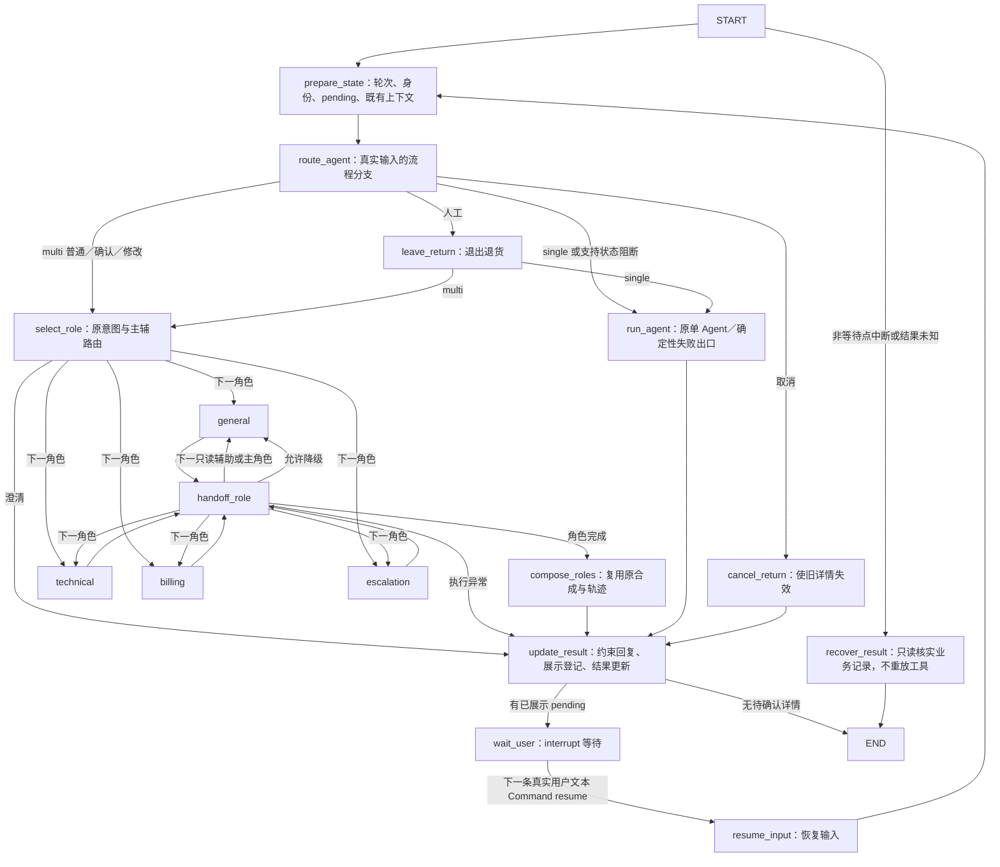

# 零售退货工作图

API／CLI 的零售共享入口默认 `RETAIL_WORKFLOW_MODE=langgraph`，single／multi 都经过同一工作图。multi 由图逐个调度原有角色，single 保持原 Agent 节点；只有已展示的待确认退货进入 Interrupt。直接构造 `RetailService` 的旧调用者默认仍用 legacy。



`agents/retail_workflow.py` 使用 `StateGraph(RetailGraphState)`、条件边、`AsyncSqliteSaver`、`interrupt()` 与 `Command(resume=真实用户文本)`。`agents/retail_agent.py` 的 `_prepare_turn`／`_execute_turn`／`_finish_turn` 同时供图与 legacy 使用，没有复制业务实现。`agents/retail_runtime.py` 装配、启动并关闭 checkpoint 连接。

图状态保存当前任务、阶段、等待原因、本轮输入、轮次、pending 操作引用、分支、结果摘要与本轮已完成节点路径。multi 另保存当前／下一角色、剩余队列、上个角色的有界信息和交接包。完整订单、展示详情、工具结果及完整角色上下文不复制到图状态。数据库是权威来源；本轮 Request 与上下文只留在当前异步调用，恢复后重新构造。

## 角色节点与交接

`agents/agent_orchestrator.py` 的 `prepare_route`、`execute_role`、`should_fallback`、`finish_single`／`finish_parallel` 同时被原 `run` 和工作图调用；没有复制整套路由或工具逻辑。`agents/retail_multi_agent.py` 的 `begin_turn` 只在真实轮次调用一次，沿用原预算和共享交易 guard。最多两个只读辅助角色先执行，主执行者最后执行，保持原零售顺序；Composer 仍按原条件决定是否调用模型。失败角色在无工具轨迹、无 pending、未进入状态操作时才允许进入 general 节点；结果未知禁止角色降级。

`agents/retail_handoff.py` 定义 `RoleOutcome`／`RoleHandoff`，派发前构建，并通过 `Request.retail_handoff` 进入目标角色实际的 `[角色输入契约]`。人工角色不调用生成模型，实际模拟交接工具摘要附带来源明确的交接信息。主要字段如下：

| 字段 | 来源与边界 |
|---|---|
| `from_role/to_role/source_turn/target_turn` | 实际执行角色与服务端轮次；同轮辅助交接及跨轮／重启可区分 |
| `task/identity` | 当前任务视图；身份每次重读服务端绑定，不能由摘要建立身份 |
| `user_report` | 当前真实输入至多 200 字，标注为用户报告 |
| `pending_refs/event_refs` | 当前业务 SQLite，分别最多 6 条操作引用／最近事件引用 |
| `support_refs` | 原 Host 工作记录：报告步骤、已检索证据 ID、未解决事项和记录轮次；不新增抽取模型 |
| `previous_role` | 上个角色的非权威说明至多 300 字、8 条工具引用、6 个证据 ID；忽略额外字段和未来轮次 |

角色说明不等于已核验事实，工具引用不复制完整结果，用户报告不等于实测。交接包中的任何字段都不能替代真实用户确认；派发和结果更新时重新读取业务引用，旧详情失效后不会从上个角色摘要恢复。第一阶段没有这些字段的等待 checkpoint 仍可恢复。取消不执行角色节点；转人工先使 pending 失效，再进入 escalation。角色执行异常且可能已有写入时，下条输入走只读核实，不重新运行角色。

SQLite checkpoint 默认位于业务库旁，如 `retail.db` 对应 `retail.checkpoints.sqlite`；可用 `RETAIL_CHECKPOINT_PATH` 指定独立文件，禁止与业务库同路径。thread_id 由服务端对业务库路径、既有 user_id 和 conv_id 的组合做 SHA256。接口不接受外部 checkpoint id 或 Command。既有 user_id／conv_id 是沙箱会话边界，并非生产登录认证。

等待节点在中断前没有副作用，恢复时不重跑此前的 Agent 节点。恢复输入只传递文本，图分支不产生交易授权；`mcp/retail_store.py::submit_return` 仍核验真实输入、展示时间、订单版本、身份、参数及事务状态。修改后需重新准备、展示并确认；取消、转人工和原支持流程的转排查可以离开等待。

Checkpoint 不保证工具恰好执行一次。非等待节点执行中断后，下一条输入只触发 `recover_result`，读取会话业务事件与 pending，报告已记录的退货数，不执行模型或工具；用户之后可查询订单再继续。工具结果未知时沿用事实约束识别，下轮也先只读核实。已有原子事务、操作编号与状态核验继续防止重复写入；没有给写操作配置自动重试。

## 零费用演示

```powershell
$env:PYTHONIOENCODING='utf-8'
uv sync --locked --group dev
uv run --locked --offline python -m evaluation.demo_retail_workflow
uv run --locked --offline python -m evaluation.demo_retail_roles
```

使用固定 Fake 模型、原公开种子和独立新目录，不读取 `.env`，不访问模型、Redis、Chroma 或云追踪。依次运行 legacy 两轮和 LangGraph 两轮，每轮为独立 Python 进程。输出 PID、实际工具、节点路径、图状态、interrupt、恢复标记、写入数、模型／工具调用数，并在打印的新目录保存 `summary.json`。这是工程演示，不能证明语义理解或回答质量提高。

第二条演示命令展示 multi 的 technical→billing 准备→重启 Resume 确认→escalation，每个引擎四轮，每轮新进程；自动比较图与 legacy 的模型／工具调用及写入数。输出包含真实角色节点、交接来源轮次、交接包与 checkpoint。Windows 先设置上方 UTF-8 环境变量，让父子进程按同一编码传递中文与金额。手动续接可用 `python -m evaluation.demo_retail_roles --directory data/demo/roles-manual --step technical`，后续依次使用同目录的 `--step prepare`、`--step resume`、`--step human`；续接会读写该演示目录。

分两次操作可演示等待期间关闭进程：

```powershell
uv run --locked --offline python -m evaluation.demo_retail_workflow --directory data/demo/u02-manual --step prepare
uv run --locked --offline python -m evaluation.demo_retail_workflow --directory data/demo/u02-manual --step resume --message "确认，就按这些申请退货"
```

请为独立演示使用新目录；`--step` 会沿用目录里的沙箱记录。实际 API／CLI 沿用原启动命令，下一次 `/chat` 或 CLI 输入会自动恢复，无需客户端发送 Command。轮次 JSONL 仍一轮一行，新增 `workflow` 字段；`GET /trace/tool/{request_id}` 的 `trace.workflow` 可查看节点、阶段、等待、恢复、耗时与调用数。`node_path` 是本轮已完成节点，`next=["wait_user"]` 与 checkpoint interrupt 表示当前等待位置。

## 回退与验证

设置 `RETAIL_WORKFLOW_MODE=legacy` 后重启 API／CLI，使用相同业务库并保留 checkpoint 文件。legacy 仍核验业务确认，不依赖图状态。之后切回时，图恢复会重新读取权威业务记录，不使用旧图布尔值授权。

```powershell
$env:RETAIL_WORKFLOW_MODE='legacy'
uv run --locked --offline python -m api.main --cli
```

离线定向检查：

```powershell
uv run --locked --offline python -m pytest tests/test_retail_workflow.py tests/test_retail_agent.py tests/test_retail_store.py tests/test_retail_response_guard.py tests/test_retail_mcp.py -q
uv run --locked --offline python -m pytest tests/test_retail_role_workflow.py -q
```

启动隔离的本地测试服务后，可运行 `tests/integration/test_retail_workflow.py` 和 `tests/integration/test_retail_role_workflow.py` 验证真实 API／stdio MCP、single／multi 的等待重启、支持记录进入角色输入及 legacy 回退，生成模型全部 Fake。图开销为本轮图调用耗时扣除共享业务阶段与角色执行／合成耗时；包括 checkpoint I/O、分支、交接构建与框架调度，不是生产 P95。调用数取预算账本与工具轨迹，轨迹中的被拦截尝试不等于实际工具执行，不新增无条件模型调用。

依赖固定为 `langgraph==1.2.16`、`langgraph-checkpoint-sqlite==3.1.2`，传递依赖由 `uv.lock` 固定。仅既有 `websockets` 为满足 SDK 约束由 17.2 调整为 16.1.1；Embedding 环境未改。传递依赖包含 LangSmith SDK，但图调用显式 `tracing_context(enabled=False)`，不使用云服务。

角色图阶段没有新增依赖、环境变量或预算，也没有修改原检索／Prompt 策略。已通过 Fake 工程检查的 multi 角色调度默认随 langgraph 采用，single 延续第一阶段；`RETAIL_WORKFLOW_MODE=legacy` 同时回退退货图和角色调度。此前真实模型退货烟测属于第一阶段，不能代替新增交接输入的真实模型兼容验证。

本地 SQLite 适用于当前单运行时沙箱。未验收多进程并发写同一会话、生产部署或 checkpoint 长期保留策略；状态无无界对话历史，但 checkpoint 历史仍占用磁盘。真实模型理解与回答质量、本地 Qwen 全组合及 RAG 质量评测不属于本轮验证。

机制依据：[LangGraph Interrupts](https://docs.langchain.com/oss/python/langgraph/interrupts) 说明恢复会重新执行等待节点；[Persistence](https://docs.langchain.com/oss/python/langgraph/persistence) 说明持久化线程状态的边界。项目据此隔离等待与业务副作用。

可如实用于简历：将零售客服的状态准备、角色路由、主辅角色执行、受控降级与结果合成拆为 LangGraph 节点，设计带来源和轮次的有界交接契约，使用独立 SQLite Checkpointer 与 Interrupt／Resume 支持退货确认和重启续接；复用既有授权、防重与工具权限，并以 Fake 验证 API／CLI 兼容和异常恢复。未测得真实回答质量或准确率收益。
