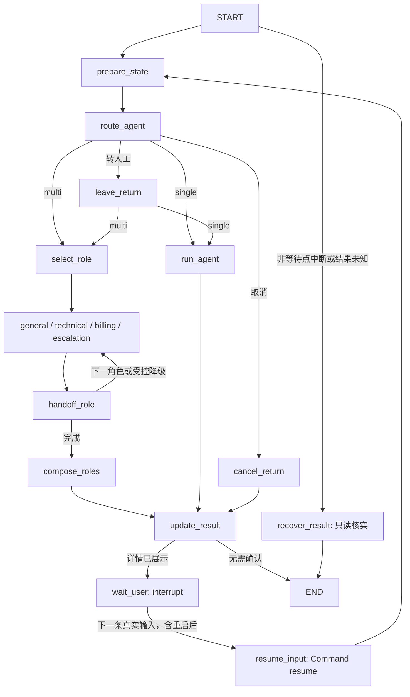

# U02：LangGraph 有状态零售 Agent 工作流

U02 完成了零售 Agent 的图式编排升级：将轮次准备、流程分支、角色执行、交接、结果更新及用户等待纳入同一 StateGraph。现有订单查询、退货和模拟人工业务继续复用原 Agent 与工具；本次主要新增执行状态的统一编排、图等待位置恢复及结构化角色交接。

## 技术与实现

| 技术 | 实际用途 | 主要代码 |
|---|---|---|
| LangGraph `StateGraph`、条件边 | 显式调度业务阶段、四种角色、取消／人工与恢复分支 | [retail_workflow.py](../agents/retail_workflow.py) |
| Python `TypedDict` | `RetailGraphState` 保存任务、阶段、等待原因、输入、业务引用、结果及角色状态 | 同上 |
| `AsyncSqliteSaver`、aiosqlite | 独立 SQLite 文件持久化图状态及等待位置，不替换业务库 | 同上 |
| `interrupt()`、`Command(resume=...)` | 展示待确认详情后暂停；下条真实用户输入到达时恢复 | 同上 |
| `RoleOutcome`、`RoleHandoff` | 有界交接包携带角色、来源轮次、用户报告、证据／工具引用及当前未解决项，进入目标角色实际输入和人工工具摘要 | [retail_handoff.py](../agents/retail_handoff.py) |
| 共享业务方法、运行时装配 | 图与 legacy 复用原逻辑，API／CLI 共用入口，原模型适配器及 MCP 工具保留 | [retail_agent.py](../agents/retail_agent.py)、[agent_orchestrator.py](../agents/agent_orchestrator.py)、[retail_runtime.py](../agents/retail_runtime.py) |

固定依赖为 `langgraph==1.2.16`、`langgraph-checkpoint-sqlite==3.1.2`；传递依赖由 `uv.lock` 固定。为兼容依赖约束，既有 websockets 从 17.2 调整为 16.1.1。LangSmith tracing 显式关闭，不使用云服务。本轮收尾没有新增依赖或下载模型。

状态不复制完整业务库或完整对话历史。服务端以业务库路径、用户和会话生成 checkpoint thread_id；恢复时重读权威身份、待确认操作和业务事件。这里沿用沙箱身份边界，不代表生产登录认证。

## 链路变化

以前：共享运行时 → RetailService 的轮次处理 → 原 Agent／Orchestrator 内部调度 → 工具 → 轮末更新；支持记录和业务状态分散在 Host 与业务 SQLite。

现在：共享运行时 → 图准备状态 → 条件分支 → 实际角色节点 → 结构化交接／合成 → 结果更新 → 按需中断等待。下图为简化视图，完整节点图见[工作图说明](RETAIL_WORKFLOW.md)。



multi 的 general、technical、billing、escalation 是独立执行节点；原主辅顺序、条件合成及受控降级继续复用。角色按顺序执行，没有新增并行角色协作。single 保持一个原 Agent 执行节点，但轮次准备、分支、结果和等待已独立成图，并非将整个 `handle_turn` 包成一个节点。

## 相比原项目新增了什么

| 原有能力 | U02 新增部分 |
|---|---|
| SQLite 业务记录、pending、支持记录和同会话续接 | 图阶段、下一节点、interrupt 等待位置也可持久化并在新进程恢复 |
| 原 Orchestrator 调用角色 | 显式角色节点、条件边、节点路径、当前角色及交接轨迹 |
| 共享支持记录与部分交接摘要 | 带来源和轮次的有界 `RoleHandoff`，统一进入目标角色和模拟人工工具 |
| 事务、op_id、身份和真实确认核验 | 恢复策略与既有交易保护衔接；未知结果先只读核实，不自动重放写操作 |
| 原工具 trace／轮次日志 | 增加 `workflow`，可查看阶段、等待、恢复、节点、模型／工具调用和图开销 |

退货仍是“准备 → 展示详情 → 用户独立确认 → 提交”，修改后重新确认，取消和人工可离开等待。等待节点在 `interrupt` 前没有业务副作用，恢复不会重跑之前已完成的 Agent 节点。Checkpoint 不提供工具恰好执行一次保证；防重仍由原业务事务和操作编号承担，图字段或 Command 参数不能授权交易。

U02 后续还修正了人工退出后摘要／交接阶段残留旧等待、item_id 被误判为 product_id 两处问题。当前视图区分 `handoff_requested` 与工具实际成功后的 `handoff_recorded`，保留历史记录及来源轮次；详见[局部修复说明](RETAIL_SUPPORT_FIXES.md)。人工仅记录模拟交接，没有真实坐席或工单。

## 运行、采用与验证

零售 API／CLI 默认 `RETAIL_WORKFLOW_MODE=langgraph`：single 使用退货工作图，multi 另使用角色节点调度；仅已展示待确认详情触发等待。直接构造 RetailService 的旧调用者仍默认 legacy。设置 `RETAIL_WORKFLOW_MODE=legacy` 后重启即可回退，保留业务库和 checkpoint；自定义文件可用 `RETAIL_CHECKPOINT_PATH`。

零费用演示，每轮为不同 Python 进程，不需要启动 Redis／Chroma：

```powershell
$env:PYTHONIOENCODING='utf-8'
uv run --locked --offline python -m evaluation.demo_retail_roles
```

演示打印 technical → billing 准备 → 等待 → 重启 Resume 确认 → escalation 的节点、checkpoint、PID 和写入数，使用 Fake 生成与独立沙箱目录。当前收尾运行中，legacy／graph 各 10 次模型调用、5 次工具调用、1 笔退货写入；图四轮开销中位 92.721 ms，范围 67.727–100.121 ms，仅演示样本，不代表生产性能或收益。

验证分阶段保留，不合并不同条件的通过率：

- 第一阶段真实模型兼容：8/8，58 请求，保守费用 ¥0.598744，覆盖 single／multi、重启确认、修改、取消及人工。
- 角色图真实兼容：六案自动业务／图检查 6/6，65 请求，保守费用 ¥0.708052；保留人工摘要和编号规则的发现记录，不追认完整语义通过。随后局部修复经过 Fake 回归，未重新付费验证。
- 修复后的最后全量：591 passed、8 项重型可选 Qwen skipped、1 既有依赖警告，480.54 秒，含四种实际 API／MCP／SQLite 组合。此次收尾复用相同源码的全量证据，补跑 32 项核心回归及上述分进程演示，均通过。

U02 两次真实兼容的历史保守费用合计 ¥1.306796；本次收尾新增付费请求 0、费用 ¥0。没有因图编排引入无条件额外模型调用；真实角色图人工配对曾比 legacy 多一次受控商品查询及模型调用，因此不能宣传所有真实场景调用数相等或效率提高。未改 Embedding、Hybrid、Reranker、政策或模型 Prompt 策略。

## 简历与面试表述

可直接使用：

> 基于 LangGraph StateGraph 构建有状态零售客服工作流，将路由、角色执行、结构化交接与结果更新建模为显式节点和条件边；使用独立 SQLite Checkpointer 与 Interrupt／Resume 实现退货确认等待及进程重启后的图状态恢复，接入共享 API／CLI 运行时并保留 legacy 回退。

可补充一条：

> 设计带来源轮次和业务引用的 RoleHandoff，贯通技术支持、退货办理与模拟人工交接；复用既有事务及 op_id 防重，通过等待节点隔离副作用和未知结果只读核实避免盲目重放，并以分进程演示及定向回归验证核心链路。

面试重点：为什么业务库与 checkpoint 分开、为什么恢复会重跑等待节点、为什么真实确认仍在工具层核验、如何区分用户报告／角色说明／业务事实，以及如何从 trace 解释一次角色切换。

当前为项目级工程收尾，未做修后真实模型补验、大样本语义质量、生产并发或 checkpoint 长期清理验收。没有训练新路由模型、长期记忆压缩或并行 Agent 新能力，也没有准确率／成功率／性能提升的可宣称收益。
